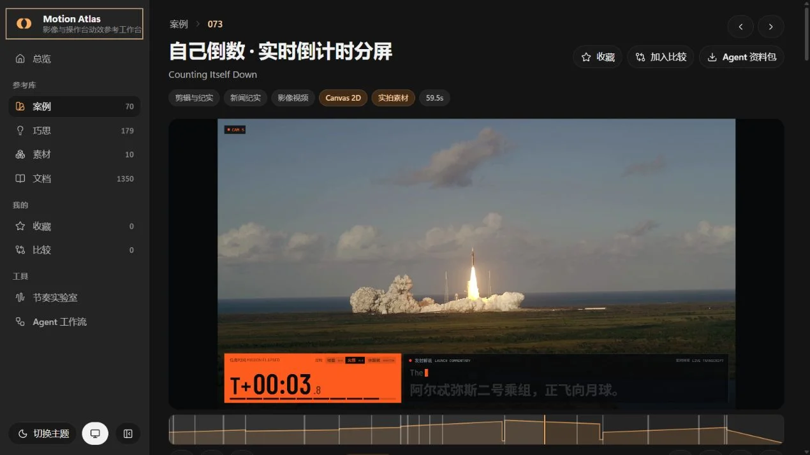

<div align="center">

# MOTION ATLAS

### 可拖动 · 可逐帧 · 可出片的影像与操作台参考库

面向**按时间线播放的影像视频、交互操作台与展示台**的参考库。完整案例展示镜头、信息层、文字、转场与声音如何协作，独立巧思提供可借用的具体机制。结合节拍表、能量曲线、动效 Token 与可复用 Prompt，可以在可运行的 Demo 中拖动时间轴、跳拍，再逐帧渲染成自己的作品。

<!-- counts:start -->
**70 个案例**　·　**179 个巧思**　·　**10 个素材**　·　**70 个可逐帧渲染的 Demo**
<!-- counts:end -->



</div>

案例提供完整作品，巧思拆解可借用的机制，素材提供制作资源。节奏实验室用节拍器、A/B 吸附、曲线和错峰演示节奏，可导出 CSS、MotionKit 乐谱、Prompt 与 WAV。

使用方式见[使用指南](docs/guide.md)，节拍与动效见[节奏方法](docs/rhythm.md)，代码出片见[渲染管线](docs/pipeline.md)。Agent 从[取材说明](docs/agent.md)和[结构化目录](agent/catalog.json)进入；也可使用[配套 skill](https://github.com/MIBXR/mibxr-skills/tree/main/skills/motion-atlas)。

## 本地运行

需要 Node.js 22+，在仓库根目录运行：

```bash
npm install
npm run dev
```

开发服务地址为 `http://localhost:5311`。`npm run dev` 会先由 `entries/` 生成 `data/` 与 `agent/`。完整构建与发布见贡献指南的[构建与检查](CONTRIBUTING.md#构建与检查)。

## 目录

| 目录 | 作用 |
| --- | --- |
| `entries/` | 案例、巧思与素材的条目 JSON。 |
| `demos/` | 条目本体，保存运行文件、制作资料与许可原文。 |
| `docs/` | 使用指南、研究与素材说明，`readme/` 保存 README 配图。 |
| `prompts/` | 由条目生成的 Prompt 文档。 |
| `agent/` | 生成的结构化目录、分类索引与单条资料包。 |
| `previews/` | 条目预览截图与作者效果图。 |
| `data/` | 生成的网站数据与素材地址映射。 |
| `kit/` | Demo 共用的 `motion-kit.js` 运行时。 |
| `site/` | React 网站源码、Arc UI 组件与 Demo 共用内容运行时。 |
| `scripts/` | 内容工具链、构建脚本、条目模板与唯一手工维护的标签字典。 |

## 许可与署名

网站界面组件复制自 Arc UI（MIT，Elia Kuratli），许可证见 [site/registry/ARC-UI-LICENSE](site/registry/ARC-UI-LICENSE)；第三方内容的许可见各条目本体的 `LICENSES.md`。

本地启动、收录规则与新增流程见[贡献指南](CONTRIBUTING.md)，修改仓库见[维护约束](AGENTS.md)。
