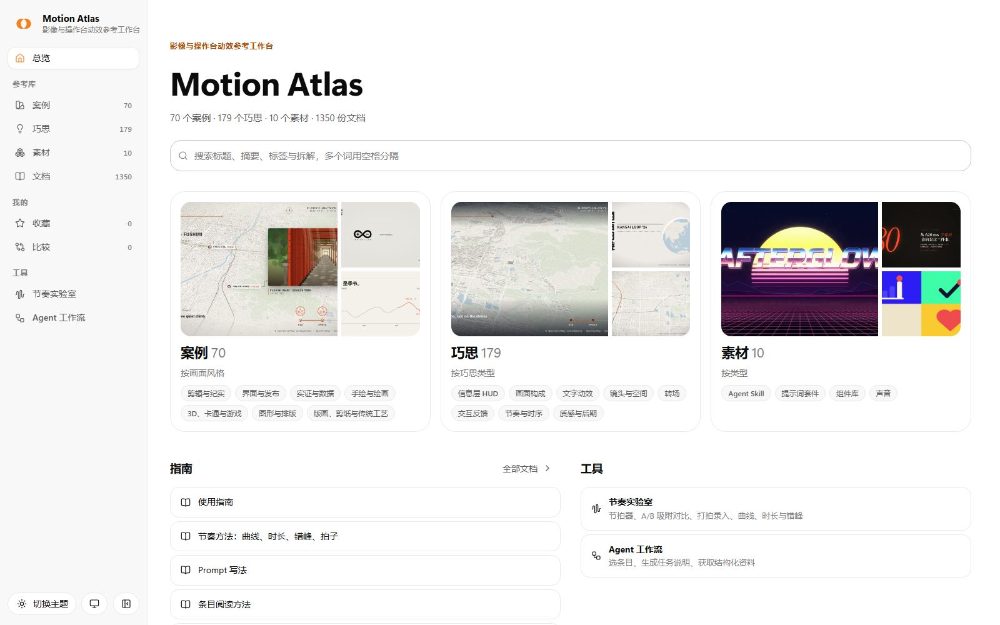
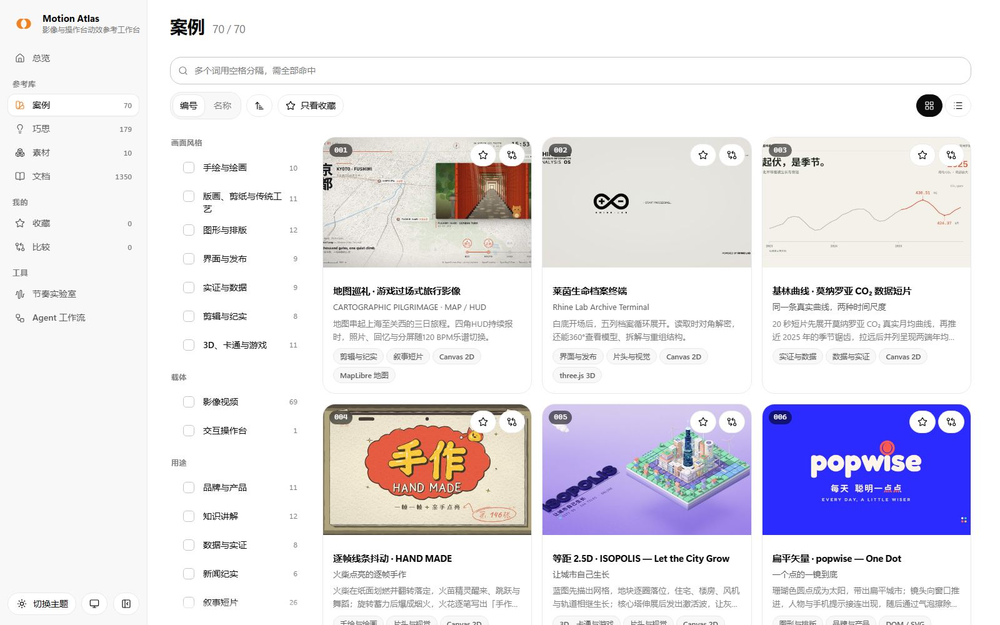
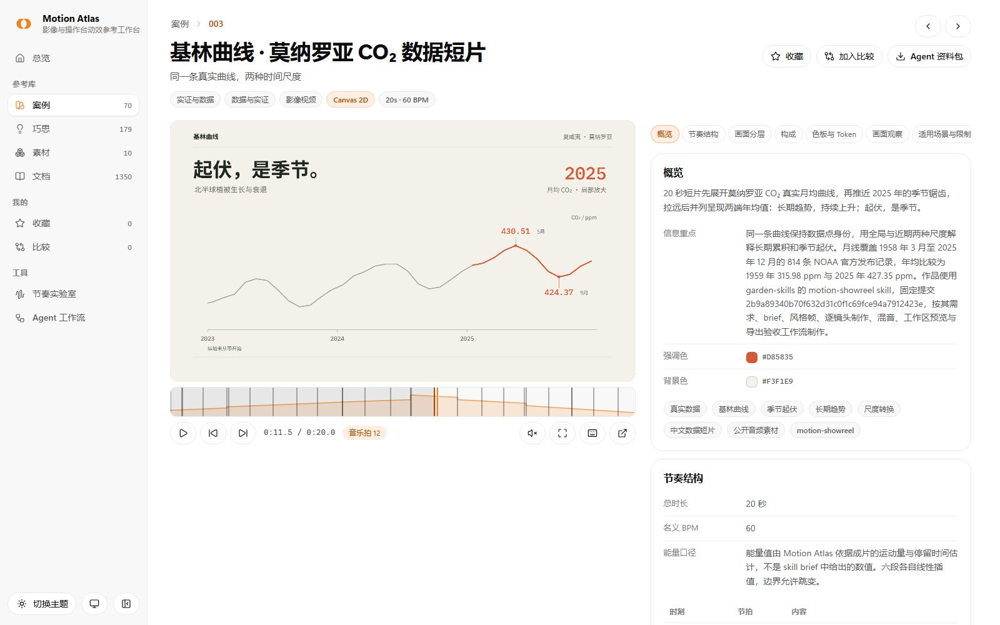
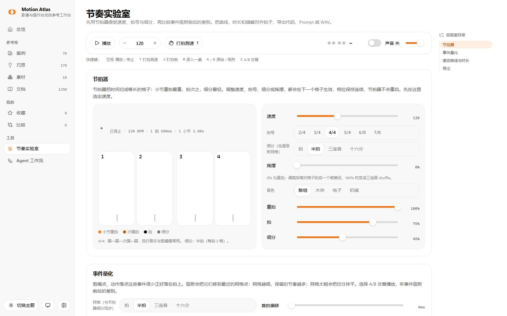
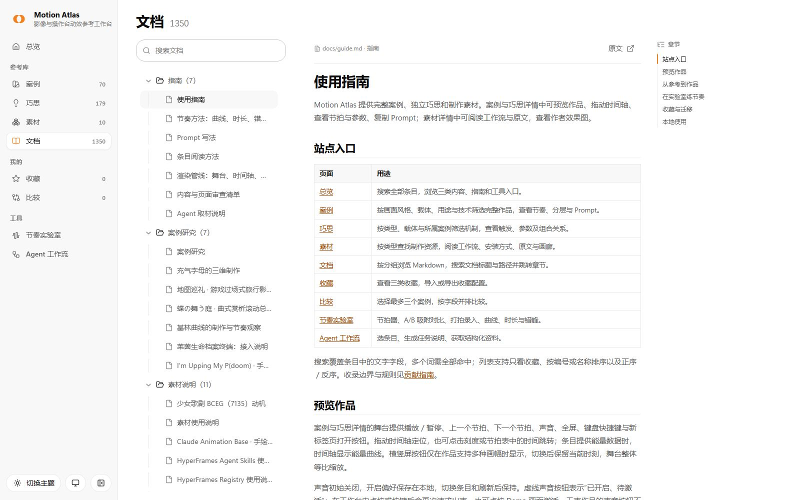
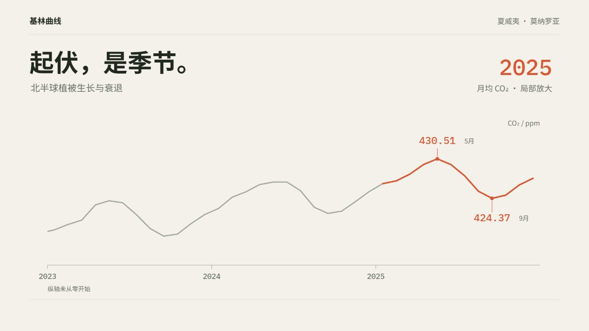
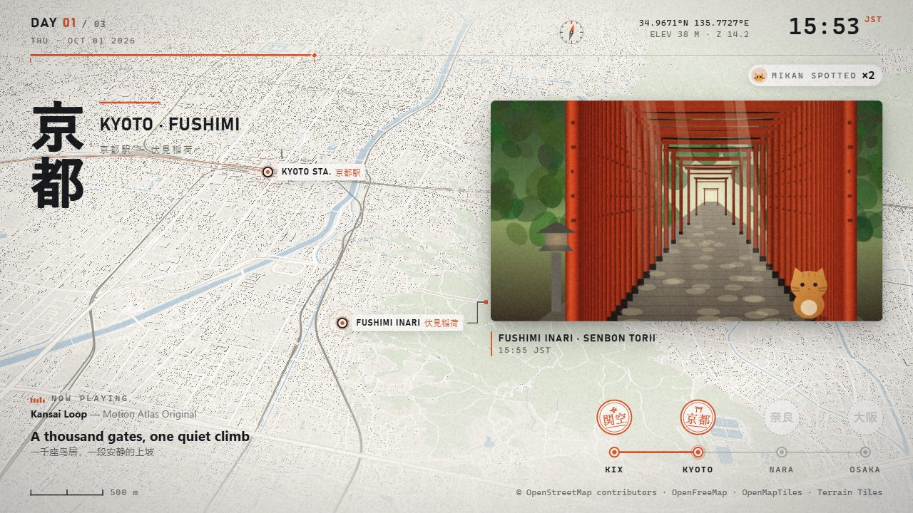
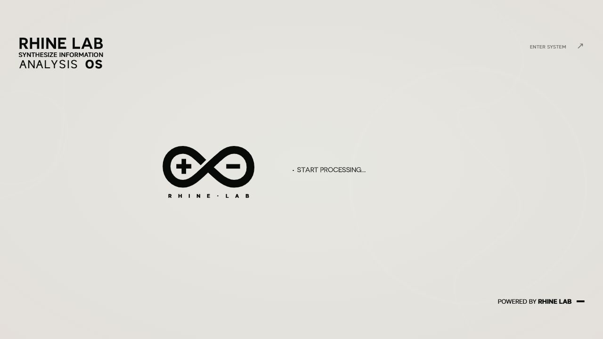
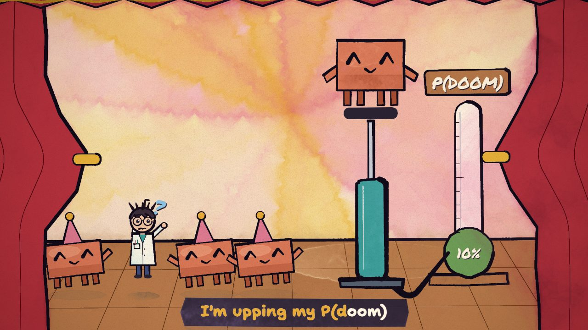
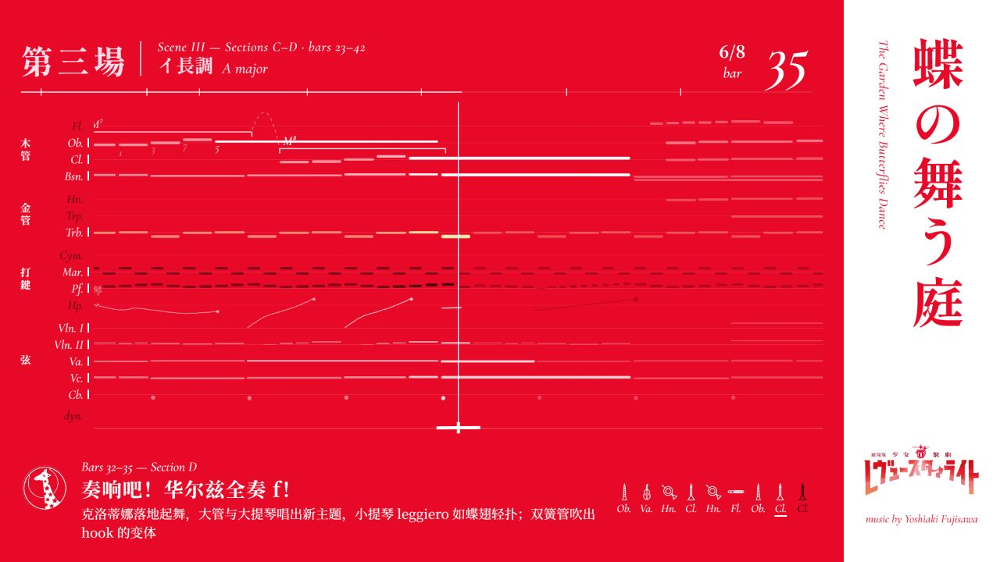

<div align="center">

# MOTION ATLAS

### 可拖动 · 可逐帧 · 可出片的影像与操作台参考库

面向按时间线播放的影像视频、交互操作台与展示台的参考库。完整案例展示镜头、信息层、文字、转场与声音如何协作，独立巧思提供可借用的具体机制。结合节拍表、能量曲线、动效 Token 与可复用 Prompt，可以在可运行的 Demo 中拖动时间轴、跳拍，再逐帧渲染成自己的作品。

<!-- counts:start -->
**70 个案例**　·　**179 个巧思**　·　**10 个素材**　·　**70 个可逐帧渲染的 Demo**
<!-- counts:end -->

[打开首页](https://motion-atlas-library.mibxranime.chatgpt.site/#/) · [案例库](https://motion-atlas-library.mibxranime.chatgpt.site/#/cases) · [巧思库](https://motion-atlas-library.mibxranime.chatgpt.site/#/patterns) · [素材库](https://motion-atlas-library.mibxranime.chatgpt.site/#/materials) · [节奏实验室](https://motion-atlas-library.mibxranime.chatgpt.site/#/tools/rhythm-lab) · [Agent 工作流](https://motion-atlas-library.mibxranime.chatgpt.site/#/tools/workflow) · [文档中心](https://motion-atlas-library.mibxranime.chatgpt.site/#/docs)


</div>

## 页面截图

| 首页 | 案例库 |
| --- | --- |
|  |  |
| 案例详情 | 巧思详情 |
|  |  |
| 节奏实验室 | 文档中心 |
|  |  |

## 精选案例

<table>
<tr>
<td width="33%" valign="top"><br><strong><a href="https://motion-atlas-library.mibxranime.chatgpt.site/#/cases/keeling-curve">基林曲线</a></strong><br>用同一条真实曲线解释长期趋势与季节起伏。<br><br><a href="prompts/cases/keeling-curve.md">Prompt</a> · <a href="docs/cases/keeling-curve.md">研究</a> · <a href="demos/cases/keeling-curve/">代码</a></td>
<td width="33%" valign="top"><br><strong><a href="https://motion-atlas-library.mibxranime.chatgpt.site/#/cases/map-pilgrimage">地图巡礼</a></strong><br>地图镜头、照片与四角信息层串起三日旅行。<br><br><a href="prompts/cases/map-pilgrimage.md">Prompt</a> · <a href="docs/cases/map-pilgrimage.md">研究</a> · <a href="demos/cases/map-pilgrimage/">代码</a></td>
<td width="33%" valign="top"><br><strong><a href="https://motion-atlas-library.mibxranime.chatgpt.site/#/cases/archive-os">莱茵生命档案终端</a></strong><br>时间线驱动档案阵列、解密读取与模型拆解。<br><br><a href="prompts/cases/archive-os.md">Prompt</a> · <a href="docs/cases/archive-os.md">研究</a> · <a href="demos/cases/archive-os/">代码</a></td>
</tr>
<tr>
<td width="33%" valign="top"><br><strong><a href="https://motion-atlas-library.mibxranime.chatgpt.site/#/cases/pdoom-video">I'm Upping My P(doom)</a></strong><br>水彩笔触、线条沸腾与逐次升级的副歌舞台。<br><br><a href="prompts/cases/pdoom-video.md">Prompt</a> · <a href="docs/cases/pdoom-video.md">研究</a> · <a href="demos/cases/pdoom-video/">代码</a></td>
<td width="33%" valign="top"><br><strong><a href="https://motion-atlas-library.mibxranime.chatgpt.site/#/cases/mg-3d-render">soft. — Soft Landing</a></strong><br>充气字母、胶囊碰撞与镜头景深组成三维短片。<br><br><a href="prompts/cases/mg-3d-render.md">Prompt</a> · <a href="docs/cases/mg-3d-render.md">研究</a> · <a href="demos/cases/mg-3d-render/">代码</a></td>
<td width="33%" valign="top"><br><strong><a href="https://motion-atlas-library.mibxranime.chatgpt.site/#/cases/butterfly-garden-score">蝶の舞う庭</a></strong><br>滚动总谱、动机高亮与红白反色呈现曲式变化。<br><br><a href="prompts/cases/butterfly-garden-score.md">Prompt</a> · <a href="docs/cases/butterfly-garden-score.md">研究</a> · <a href="demos/cases/butterfly-garden-score/">代码</a></td>
</tr>
</table>

完整作品与研究入口见[案例索引](docs/cases/README.md)。

## 核心用法

### 在网站上用

从首页跨库搜索，或在案例、巧思、素材列表按画面风格、载体、用途与关键词筛选。详情左侧运行 Demo，可拖动时间轴、跳拍与切换支持的画幅，右侧阅读节奏、分层与本节目录；复制 Prompt 或下载 Agent 资料包后取材。

收藏保存常用条目，比较页并排查看最多 3 个案例。节奏实验室提供节拍器、A/B 吸附、打拍录入、缓动与错峰控件，可导出 CSS、MotionKit 乐谱、Prompt 与 WAV；素材的取用方式见[素材使用说明](docs/materials/README.md)。

### 交给 Agent 用

[配套 skill](https://github.com/MIBXR/mibxr-skills/tree/main/skills/motion-atlas) 根据需求筛选、比较并取得资料；[agent/catalog.json](agent/catalog.json) 提供案例、巧思与素材的结构化入口。已有本地仓库时，`search` 查找候选，`show` 读取完整说明，`export` 导出源码、素材与文档到新目录：

```sh
node scripts/atlas.mjs search "地图" --kind cases --limit 3
node scripts/atlas.mjs show map-pilgrimage
node scripts/atlas.mjs export map-pilgrimage --out ../map-reference
```

巧思与素材通过 `--kind patterns`、`--kind materials` 筛选，`show` 与 `export` 直接使用条目 id；参数与取材方式见[Agent 取材说明](docs/agent.md)。

### 本地运行

使用 Node.js 22.12 或更新版本，在仓库根目录执行：

```sh
npm install
npm run build
npm run dev
```

默认开发端口为 `5311`，打开终端显示的本地地址；`Ctrl+C` 结束服务。构建与发布见[贡献指南](CONTRIBUTING.md#构建与检查)，逐帧出片见[渲染管线](docs/pipeline.md#九逐帧渲染成视频)。

## 目录

| 目录 | 用途 |
| --- | --- |
| `entries/` | 案例、巧思与素材的结构化条目 |
| `demos/` | 可运行作品、素材、制作资料与许可 |
| `docs/` | 使用指南、研究、素材说明与 README 配图 |
| `prompts/` | 构建生成的复用 Prompt |
| `agent/` | 构建生成的目录、索引与 Agent 资料包 |
| `previews/` | 案例、巧思与素材的现成预览图 |
| `data/` | 构建生成的站点数据与素材映射 |
| `kit/` | Demo 共用的 MotionKit 运行时 |
| `site/` | 站点页面、组件、Arc UI 与共享运行时 |
| `scripts/` | 内容构建、检查、检索、导出与发布工具 |

## 许可与署名

站点使用的 Arc UI 许可见 [ARC-UI-LICENSE](site/registry/ARC-UI-LICENSE)。第三方代码、字体、图像与音视频的许可和署名保存在各条目本体的许可文件及 `LICENSES.md` 中。

[使用指南](docs/guide.md) · [贡献指南](CONTRIBUTING.md) · [维护约束](AGENTS.md)
